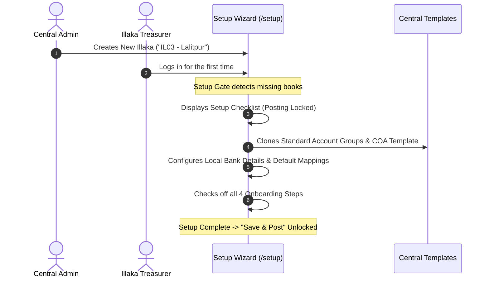

# Multi-Illaka Tenancy Architecture: How It Is Set Up & Why

**Status:** Official Architectural Reference  
**Applicability:** Syasyah Samaj Monorepo (`apps/billing`, `src/collections`)  
**Core Reference:** [`docs/illaka/PLAN.md`](file:///Users/aayurtshrestha/Projects/supreme/syasyah-samaj/docs/illaka/PLAN.md)

---

## 1. Executive Summary & Core Philosophy

The Syasyah Samaj platform operates under a **Centralized Multi-Illaka (Federated Branch) Accounting Architecture**:

> **Guiding Principle:**  
> *Independent Local Operation + Centralized Oversight & Audit + Controlled Official Communication.*

Each **Illaka** (regional sub-organization/branch) operates as an autonomous operational unit. Central does **not** micromanage day-to-day data entry; local illaka treasurers record their own receipts, payments, and activities. However, the Central Executive and Central Auditors retain complete real-time visibility, consolidation capabilities, and audit control across all branches.

```
                    CENTRAL ORGANIZATION (C00)
                    ├── Central Admin & Board
                    └── Central Audit & Treasury
                               │
               ┌───────────────┴───────────────┐
               ▼                               ▼
       CENTRAL REPOSITORIES           CONSOLIDATED REPORTING
      (Standard Templates)           (Audit, Union Statements)
               │                               │
    ┌──────────┴──────────┬────────────────────┴──────────┐
    ▼                     ▼                               ▼
 Illaka 01             Illaka 02                       Illaka N
 (Branch Ward 4)       (Branch Ward 9)                 (Future Branch)
  ├─ Own Bank/Cash      ├─ Own Bank/Cash                ├─ Own Bank/Cash
  ├─ Own Members        ├─ Own Members                  ├─ Own Members
  ├─ Own Vouchers       ├─ Own Vouchers                 ├─ Own Vouchers
  └─ Own Stock          └─ Own Stock                    └─ Own Stock
```

---

## 2. Common vs. Scoped Entities: The "Template vs. Instance" Model

### The Common Intuition:
*"Why aren't Chart of Accounts, Parties, and Inventory completely global/common across all illakas?"*

### The Accounting & Practical Reality:
If accounts, parties, and stock were kept in a single unpartitioned pool, the system would immediately fail real-world accounting and operational requirements:

#### A. Chart of Accounts (`accounts`)
* **The Problem:** Illaka 01 has its own local bank account (*e.g., Nepal Bank Ltd in Lalitpur*). Illaka 02 has its own account (*e.g., Global IME in Kathmandu*).
* **Why Global Fails:** If there was only one shared "Bank" account (#1010), posting a receipt in Illaka 01 would mix its funds with Illaka 02. The balance sheet would not reflect who actually holds the cash.
* **The Architectural Solution:** **Standardized Template &rarr; Cloned Local Instances**.
  Central defines a **Master COA Template** (standard NGO classification). When an Illaka is created, it clones that template into its own chart:
  - Illaka 01 has: `01-1000 Cash`, `01-1010 Nepal Bank Ltd`, `01-4100 Membership Fee`
  - Illaka 02 has: `02-1000 Cash`, `02-1010 Global IME Bank`, `02-4100 Membership Fee`
  - Central's accounts live under `C00-xxxx`.
  - **Consolidation:** Because each account is keyed by `(illaka, code)`, the Central Consolidated Trial Balance is a clean union ($\sum \text{Illakas}$) with **zero collisions and zero double-counting**.

#### B. Parties (`parties`: Customers, Vendors, Donors)
* **The Problem:** Illaka 01 buys tea and snacks from a local shop in Patan; Illaka 05 hires a sound system vendor in Bhaktapur.
* **Why Global Fails:** A single shared party pool would pollute every local accountant's dropdown with hundreds of irrelevant neighborhood vendors from other districts.
* **The Architectural Solution:** Vendors and local donors are **illaka-scoped**. Central vendors or nationwide donors belong to Central (`C00`).

#### C. Inventory & Items (`items`, `stockMovements`)
* **The Problem:** Physical inventory (e.g. 50 ceremonial robes, 30 books, event sound equipment) physically resides in Illaka 01's storeroom.
* **Why Global Fails:** Illaka 02 cannot deduct or issue stock that physically sits in Illaka 01's room without a physical stock transfer.
* **The Architectural Solution:** Stock balances, warehouses, and movements belong strictly to the Illaka that has physical custody of the goods.

---

## 3. Data Scoping Matrix

| Collection | Wire Field | Scope | Architectural Rule |
| :--- | :---: | :---: | :--- |
| **`tenants`** | `id` | **Org-Wide** | The Illaka directory. Central is tenant `C00`; Illakas are `IL01`, `IL02`, etc. |
| **`users`** | `tenants[]` | **Org-Wide** | 0 tenants = Central admin; 1 tenant = locked Illaka user; $N$ = Central multi-scope auditor. |
| **`accountGroups`** | None | **Org-Wide** | Shared COA hierarchy (Assets, Liabilities, Equity, Income, Expense). Defines uniform reporting. |
| **`membershipTypes`** | None | **Org-Wide** | Categories (Basic, Life, Patron) and standard fees defined centrally. |
| **`taxTypes`** | None | **Org-Wide** | Uniform tax rules (13% VAT, standard TDS rates). |
| **`accounts`** | `tenant` | **Illaka-Scoped** | Cloned from Central Template; each Illaka tracks its own distinct bank/cash balances. |
| **`documents`** | `tenant` | **Illaka-Scoped** | Invoices, bills, receipts, and vouchers belong to exactly one Illaka. |
| **`journalEntries`** | `tenant` | **Illaka-Scoped** | Every posted debit and credit carries the illaka ID; cross-tenant journal lines are strictly forbidden. |
| **`parties`** | `tenant` | **Illaka-Scoped** | Local suppliers, customers, and ward-level donors. |
| **`items`** | `tenant` | **Illaka-Scoped** | Physical stock items tracked where goods are physically held. |
| **`fixedAssets`** | `tenant` | **Illaka-Scoped** | Equipment, computers, and land owned/held by the specific branch. |
| **`programs`** | `tenant` | **Illaka-Scoped** | Cost-center tracking for local cultural events and social welfare initiatives. |
| **`auditLogs`** | None | **Org-Wide** | Immutable security log; Central auditors can inspect any action taken across any illaka. |

---

## 4. Cross-Illaka Money Transfers (Double-Legged Atomic Routing)

When Central grants money to an Illaka (or an Illaka remits dues to Central), the system **never writes a single lazy transfer entry**. 

Instead, it writes **two linked, atomic postings** connected by a `transferRef`:

```
Example: Central grants NPR 50,000 to Illaka 02 (Program Grant)

[Central Books (C00)]
  Dr. 5200 Grant Disbursed to Illakas ......... NPR 50,000
      Cr. 1010 Central Main Bank ................. NPR 50,000

[Illaka 02 Books (IL02)]
  Dr. 1010 Illaka 02 Local Bank .............. NPR 50,000
      Cr. 4200 Central Grant Received ............ NPR 50,000
```

### Safety Guarantees:
1. **Single Database Transaction:** If either leg fails, both legs rollback.
2. **Atomic Voiding:** If a transfer is voided, both sides are reversed simultaneously. One side can never be left unbalanced.

---

## 5. Why the Setup Wizard Exists & How It Works

Because each Illaka has its own independent ledger, a newly added Illaka starts with empty books.



### The 4 Readiness Gates:
1. **Company Profile**: Org name, local branch address, PAN/VAT.
2. **Fiscal Year**: Active accounting year driving voucher numbering (e.g. `2083/84`).
3. **Chart of Accounts**: Starter chart cloned from Central template.
4. **Default Accounts**: The 8 core control accounts mapped (`receivable`, `payable`, `cash`, `bank`, `tax`, `inventory`, `revenue`, `expense`).

---

## 6. Central Role vs. Illaka Role Experience

| Role Type | Navigation Bar | Data Access | Primary Tasks |
| :--- | :--- | :--- | :--- |
| **Illaka User**<br/>*(e.g., Illaka Treasurer)* | Locked badge: `[Illaka 02]` | Strictly limited to Illaka 02's records. Cannot see or query other illakas. | Entering vouchers, managing members, registering local assets, tracking local programs. |
| **Central User**<br/>*(e.g., Central Auditor, Super Admin)* | Tenant Switcher dropdown:<br/>`[All Consolidated ▾]` | Can switch to any individual Illaka, or view `All (Consolidated)`. | Organization-wide audits, reviewing government fund utilization, issuing official correspondence, running consolidated financial statements. |
