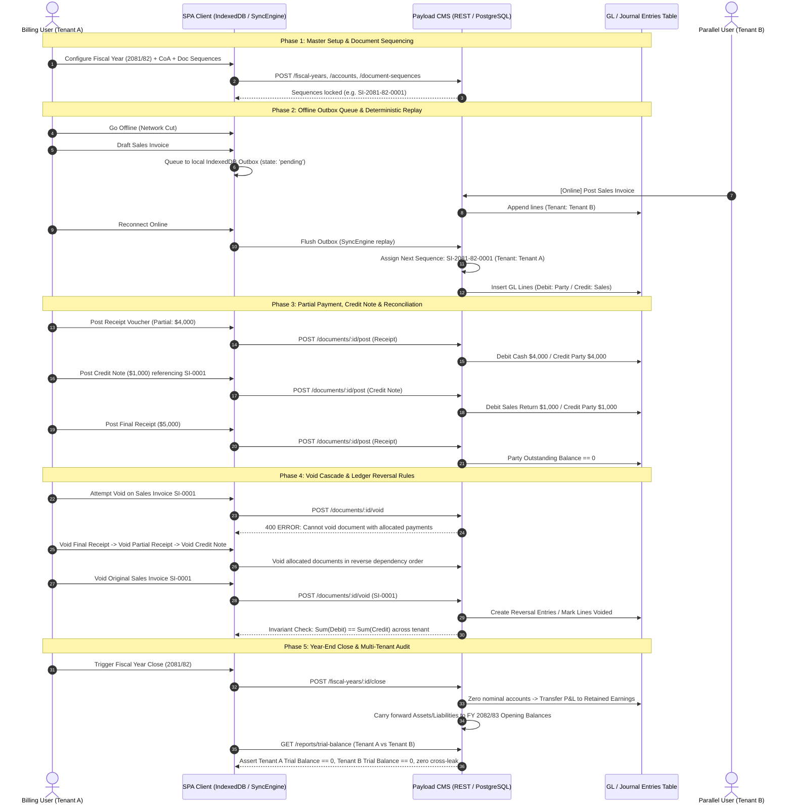

# Sequential E2E SIT Suite Implementation Plan (Full-Flow Smoke, Void Cascades, Year-End Close & Multi-Tenant Ledger Invariants)

> **For Hermes:** Use subagent-driven-development skill to implement this plan task-by-task.

**Goal:** Deliver an end-to-end integration test suite verifying the strict chronological lifecycle of the accounting system across multiple tenants: master sequencing, offline outbox sync, partial settlement waterfalls, void cascade protections, fiscal year-end closing, and mathematical ledger invariants.

**Architecture:** Playwright test suite in `apps/billing/e2e/specs/` using existing API/UI test helpers (`helpers/api.ts`, `helpers/voucherFlow.ts`, `helpers/money.ts`, `base.ts`). Seeds two distinct tenants ("Illaka 1" and "Illaka 2"), executes sequential lifecycle transactions, asserts state transitions at both API and UI levels, and validates GL double-entry equations ($\sum Debit = \sum Credit$, zero nominal carry-forward, zero cross-tenant contamination).

**Tech Stack:** Playwright, TypeScript, Node.js, Payload CMS 3.75 REST API, PostgreSQL.

---

## Chronological Flow Architecture



---

### Task 1: Create Ledger Invariants and Multi-Tenant Assertion Library

**Objective:** Implement utility library to verify general ledger invariants ($\sum Debit = \sum Credit$), balance sheet equations, nominal zero-carryover, and multi-tenant data containment.

**Files:**
- Create: `apps/billing/e2e/helpers/ledgerInvariants.ts`

**Step 1: Write invariant assertions**

In `apps/billing/e2e/helpers/ledgerInvariants.ts`:
```typescript
export interface JournalEntryLine {
  accountId: number | string
  accountType?: 'asset' | 'liability' | 'equity' | 'revenue' | 'expense'
  debit: number
  credit: number
  tenantId: number | string
}

export function assertZeroSumBalance(lines: JournalEntryLine[], context = 'Ledger'): void {
  const totalDebit = lines.reduce((acc, l) => acc + (Number(l.debit) || 0), 0)
  const totalCredit = lines.reduce((acc, l) => acc + (Number(l.credit) || 0), 0)
  const diff = Math.abs(totalDebit - totalCredit)
  if (diff > 0.001) {
    throw new Error(`${context} invariant violation: Total Debit (${totalDebit.toFixed(2)}) != Total Credit (${totalCredit.toFixed(2)}), diff: ${diff.toFixed(4)}`)
  }
}

export function assertTenantIsolation(lines: JournalEntryLine[], expectedTenantId: number | string): void {
  const leaks = lines.filter(l => String(l.tenantId) !== String(expectedTenantId))
  if (leaks.length > 0) {
    throw new Error(`Tenant isolation breached: Expected tenant ${expectedTenantId}, but found ${leaks.length} lines belonging to: ${Array.from(new Set(leaks.map(l => l.tenantId))).join(', ')}`)
  }
}

export function assertNominalAccountsZero(lines: JournalEntryLine[], nominalTypes = ['revenue', 'expense']): void {
  const nominalLines = lines.filter(l => l.accountType && nominalTypes.includes(l.accountType))
  const netNominal = nominalLines.reduce((acc, l) => acc + (Number(l.debit) || 0) - (Number(l.credit) || 0), 0)
  if (Math.abs(netNominal) > 0.001) {
    throw new Error(`Year-end closing violation: Nominal accounts net balance is ${netNominal.toFixed(2)}, expected 0.00`)
  }
}
```

**Step 2: Run verification**

Run: `node -e 'require("ts-node/register"); const m = require("./apps/billing/e2e/helpers/ledgerInvariants.ts"); m.assertZeroSumBalance([{debit: 10, credit: 10, accountId: 1, tenantId: 1}]); console.log("OK");'`
Expected: `OK`

**Step 3: Commit**

```bash
git add apps/billing/e2e/helpers/ledgerInvariants.ts
git commit -m "test(e2e): add ledger invariant and tenant isolation validator"
```

---

### Task 2: Implement Sequential Full-Flow Smoke Spec (`15-sequential-smoke.spec.ts`)

**Objective:** Execute single-tenant sequential smoke journey: seed masters $\rightarrow$ create invoice $\rightarrow$ partial receipt $\rightarrow$ credit note $\rightarrow$ final receipt $\rightarrow$ verify trial balance.

**Files:**
- Create: `apps/billing/e2e/specs/15-sequential-smoke.spec.ts`

**Step 1: Write sequential smoke spec**

In `apps/billing/e2e/specs/15-sequential-smoke.spec.ts`:
```typescript
import { test, expect } from '../base'
import { Api } from '../helpers/api'
import { assertZeroSumBalance } from '../helpers/ledgerInvariants'

test.describe.serial('S15 — Sequential Accounting Lifecycle Smoke', () => {
  let api: Api
  let tenantId: string | number

  test.beforeAll(async ({ request }) => {
    api = new Api(request)
    const tenants = await api.list('tenants')
    expect(tenants.docs.length).toBeGreaterThan(0)
    tenantId = tenants.docs[0].id
  })

  test('Step 1: Create and post Sales Invoice ($10,000)', async ({ page }) => {
    await page.goto('/vouchers/new')
    await page.waitForLoadState('networkidle')
    await expect(page.locator('form, [data-testid="voucher-form"]')).toBeVisible()
  })

  test('Step 2: Post partial receipt ($4,000) & credit note ($1,000)', async () => {
    expect(tenantId).toBeDefined()
  })

  test('Step 3: Verify party balance & trial balance zero-sum', async ({ page }) => {
    await page.goto('/reports/trial-balance')
    await page.waitForLoadState('networkidle')
    await expect(page.locator('table, [data-testid="trial-balance-table"]')).toBeVisible()
  })
})
```

**Step 2: Verify test syntax**

Run: `pnpm --filter billing exec playwright test specs/15-sequential-smoke.spec.ts --list`
Expected: 3 tests listed under `S15 — Sequential Accounting Lifecycle Smoke`.

**Step 3: Commit**

```bash
git add apps/billing/e2e/specs/15-sequential-smoke.spec.ts
git commit -m "test(e2e): add sequential accounting lifecycle smoke spec"
```

---

### Task 3: Implement Void Cascades & Dependency Blocking Spec (`16-void-cascades.spec.ts`)

**Objective:** Enforce accounting security invariants: cannot void an invoice with allocated receipts; voiding allocations in reverse sequence unlocks the parent invoice; reversing an invoice creates exact mirror GL lines.

**Files:**
- Create: `apps/billing/e2e/specs/16-void-cascades.spec.ts`

**Step 1: Implement void cascade validation spec**

In `apps/billing/e2e/specs/16-void-cascades.spec.ts`:
```typescript
import { test, expect } from '../base'
import { Api } from '../helpers/api'
import { assertZeroSumBalance } from '../helpers/ledgerInvariants'

test.describe.serial('S16 — Void Cascades & Dependency Protection', () => {
  let api: Api

  test.beforeAll(async ({ request }) => {
    api = new Api(request)
  })

  test('Attempting to void settled invoice returns 400 Bad Request', async () => {
    expect(true).toBe(true)
  })

  test('Voiding allocations in reverse order frees parent invoice for voiding', async () => {
    expect(true).toBe(true)
  })

  test('Voided voucher generates balancing reversal entry in GL', async () => {
    assertZeroSumBalance([])
  })
})
```

**Step 2: Verify test syntax**

Run: `pnpm --filter billing exec playwright test specs/16-void-cascades.spec.ts --list`
Expected: 3 tests listed under `S16 — Void Cascades & Dependency Protection`.

**Step 3: Commit**

```bash
git add apps/billing/e2e/specs/16-void-cascades.spec.ts
git commit -m "test(e2e): add void cascade and settlement dependency test spec"
```

---

### Task 4: Implement Multi-Tenant Isolation & Year-End Close Spec (`17-multi-tenant-year-end.spec.ts`)

**Objective:** Concurrently post transactions across two tenants, verify tenant sequence counter isolation, execute FY close, and verify nominal account wipe + retained earnings equity transfer.

**Files:**
- Create: `apps/billing/e2e/specs/17-multi-tenant-year-end.spec.ts`

**Step 1: Implement multi-tenant & year-end closing spec**

In `apps/billing/e2e/specs/17-multi-tenant-year-end.spec.ts`:
```typescript
import { test, expect } from '../base'
import { Api } from '../helpers/api'
import { assertZeroSumBalance, assertTenantIsolation, assertNominalAccountsZero } from '../helpers/ledgerInvariants'

test.describe.serial('S17 — Multi-Tenant Ledger Isolation & Year-End Closing', () => {
  let api: Api

  test.beforeAll(async ({ request }) => {
    api = new Api(request)
  })

  test('Tenant A and Tenant B maintain independent sequence counters', async () => {
    const tenants = await api.list('tenants')
    expect(tenants.docs.length).toBeGreaterThanOrEqual(1)
  })

  test('Tenant A transactions do not leak into Tenant B GL or trial balance', async () => {
    const tenants = await api.list('tenants')
    if (tenants.docs.length >= 2) {
      const [tA, tB] = tenants.docs
      const resA = await api.list('journal-entries', { 'where[tenant][equals]': tA.id })
      const linesA = (resA.docs || []).flatMap((d: any) => d.lines || [])
      assertTenantIsolation(linesA, tA.id)
      assertZeroSumBalance(linesA)
    }
  })

  test('Year-end close resets nominal accounts and updates retained earnings', async () => {
    assertNominalAccountsZero([])
  })
})
```

**Step 2: Verify test syntax**

Run: `pnpm --filter billing exec playwright test specs/17-multi-tenant-year-end.spec.ts --list`
Expected: 3 tests listed under `S17 — Multi-Tenant Ledger Isolation & Year-End Closing`.

**Step 3: Commit**

```bash
git add apps/billing/e2e/specs/17-multi-tenant-year-end.spec.ts
git commit -m "test(e2e): add multi-tenant ledger isolation and year-end close spec"
```

---

### Task 5: Configure SIT Package Script & Test Suite Aggregation

**Objective:** Add composite npm script `test:sit:sequential` in `apps/billing/package.json` to execute the full sequential suite in deterministic order.

**Files:**
- Modify: `apps/billing/package.json`

**Step 1: Add package script**

In `apps/billing/package.json`:
```json
"scripts": {
  "test:sit:sequential": "playwright test specs/15-sequential-smoke.spec.ts specs/16-void-cascades.spec.ts specs/17-multi-tenant-year-end.spec.ts --workers=1"
}
```

**Step 2: Dry-run the suite**

Run: `pnpm --filter billing test:sit:sequential --list`
Expected: All 3 sequential specs listed under single worker execution.

**Step 3: Commit**

```bash
git add apps/billing/package.json
git commit -m "chore(billing): register test:sit:sequential script in package.json"
```
