# Implementation Plan: Plans Module Completion & UI Integration

**Date:** 2026-11-21  
**Status:** Ready for Review / Execution  
**Target:** Monorepo (`apps/billing`, `src/collections/FixedAssets`)

---

## Executive Summary & Objectives

This plan addresses the gaps identified between the architectural specifications in [`docs/plans/`](file:///Users/aayurtshrestha/Projects/supreme/syasyah-samaj/docs/plans) and their actual UI implementations:

1. **Transaction Line UI Integration**: Replace the legacy inline table in [`VoucherForm.tsx`](file:///Users/aayurtshrestha/Projects/supreme/syasyah-samaj/apps/billing/src/pages/VoucherForm.tsx) with the standalone [`TransactionLine.tsx`](file:///Users/aayurtshrestha/Projects/supreme/syasyah-samaj/apps/billing/src/components/TransactionLine.tsx) and calculation engine ([`transactionCalc.ts`](file:///Users/aayurtshrestha/Projects/supreme/syasyah-samaj/apps/billing/src/lib/transactionCalc.ts)).
2. **Fixed Assets Full Workflow**: Elevate [`FixedAssets.tsx`](file:///Users/aayurtshrestha/Projects/supreme/syasyah-samaj/apps/billing/src/pages/FixedAssets.tsx) from a basic table to the planned 4-tab experience (Register, Batch Depreciation Run, Asset Disposal, Asset Reports) with supporting backend endpoints.
3. **Reports Module Standardization & Completion**: Commit pending Stage 1–3 reports, migrate report views to the shared [`ReportLayout.tsx`](file:///Users/aayurtshrestha/Projects/supreme/syasyah-samaj/apps/billing/src/components/ReportLayout.tsx), implement Stage 4 & 5 reports (Fixed Assets & Nonprofit/Membership), and fix the flaky test in [`OrderDocTypes.test.tsx`](file:///Users/aayurtshrestha/Projects/supreme/syasyah-samaj/apps/billing/src/pages/OrderDocTypes.test.tsx).

---

## Architecture & Work Breakdown

```mermaid
flowchart TD
    subgraph Phase1["Phase 1: Transaction Line UI Integration"]
        T1["Verify LineInput & VoucherForm State"] --> T2["Wire TransactionLine into VoucherForm.tsx"]
        T2 --> T3["Synchronize transactionCalc with VoucherForm totals"]
        T3 --> T4["Verify Sales, Purchase & Journal workflows"]
    end

    subgraph Phase2["Phase 2: Fixed Assets Full Workflow"]
        FA1["Add Backend Endpoints: /depreciation-run & /:id/dispose"] --> FA2["Add 4-Tab Navigation in FixedAssets.tsx"]
        FA2 --> FA3["Build Batch Depreciation Run Modal & Workflow"]
        FA3 --> FA4["Build Asset Disposal Modal & Journal Generator"]
    end

    subgraph Phase3["Phase 3: Reports Module Standardization"]
        R1["Stage & Commit Pending Stage 1-3 Reports"] --> R2["Refactor Reports to use ReportLayout.tsx"]
        R2 --> R3["Build Stage 4 Fixed Asset Reports"]
        R3 --> R4["Build Stage 5 Nonprofit & Member Reports"]
        R4 --> R5["Fix Flaky Test in OrderDocTypes.test.tsx"]
    end

    Phase1 --> Phase4["Phase 4: Full Suite Testing & Verification"]
    Phase2 --> Phase4
    Phase3 --> Phase4
```



---

## Detailed Implementation Phases

### Phase 1: Transaction Line UI Integration ([`transaction-line.md`](file:///Users/aayurtshrestha/Projects/supreme/syasyah-samaj/docs/plans/transaction-line.md))

#### 1.1 State Mapping & Prop Synchronization
- In [`VoucherForm.tsx`](file:///Users/aayurtshrestha/Projects/supreme/syasyah-samaj/apps/billing/src/pages/VoucherForm.tsx), map the existing voucher lines state to match `LineInput` from [`transactionCalc.ts`](file:///Users/aayurtshrestha/Projects/supreme/syasyah-samaj/apps/billing/src/lib/transactionCalc.ts):
  - Ensure fields: `key`, `item`, `account`, `subAccount`, `description`, `qty`, `rate`, `discount`, `discountType`, `taxCode`, `taxRate`, `amount`.
  - Derive `transactionType` dynamically from `docType`:
    - `sales-invoice`, `sales-order`, `sales-quote`, `credit-note`, `receipt-voucher` &rarr; `'sales'` / `'receipt'`
    - `purchase-invoice`, `purchase-order`, `debit-note`, `payment-voucher` &rarr; `'purchase'` / `'payment'`
    - `journal-voucher`, `contra` &rarr; `'journal'`

#### 1.2 Wire [`TransactionLine.tsx`](file:///Users/aayurtshrestha/Projects/supreme/syasyah-samaj/apps/billing/src/components/TransactionLine.tsx) into Table Body
- Replace lines 1224–1380 in [`VoucherForm.tsx`](file:///Users/aayurtshrestha/Projects/supreme/syasyah-samaj/apps/billing/src/pages/VoucherForm.tsx) with `<TransactionLine>`:
  ```tsx
  <TransactionLine
    key={l.key}
    line={l}
    index={i}
    items={items}
    accounts={accounts}
    taxTypes={taxTypes}
    transactionType={resolvedTxType}
    disabled={isReadOnly}
    onChange={(key, patch) => updateLine(key, patch)}
    onRemove={(key) => removeLine(key)}
  />
  ```
- Support keyboard navigation (`data-grid-cell` navigation or Enter-to-append row).
- Allow account override if permissible by accounting rules.

#### 1.3 Total Calculations via Engine
- Replace disparate invoice math with `calcDocTotals(lines, { discountMode, roundTo: 2 })` from [`transactionCalc.ts`](file:///Users/aayurtshrestha/Projects/supreme/syasyah-samaj/apps/billing/src/lib/transactionCalc.ts).
- Verify double-entry balancing and tax control accounts on voucher submission.

---

### Phase 2: Fixed Assets Module Expansion ([`fixed-assets.md`](file:///Users/aayurtshrestha/Projects/supreme/syasyah-samaj/docs/plans/fixed-assets.md))

#### 2.1 Server Endpoints in [`src/collections/FixedAssets/index.ts`](file:///Users/aayurtshrestha/Projects/supreme/syasyah-samaj/src/collections/FixedAssets/index.ts)
1. **Batch Depreciation Run (`POST /fixed-assets/depreciation-run`)**:
   - Request: `{ asOf?: string, category?: string, dryRun?: boolean }`
   - Logic: Query all active, non-fully-depreciated assets; calculate eligible months; detect previously posted periods to prevent duplicates; return summary and create atomic journal entries per eligible asset when `dryRun = false`.
2. **Asset Disposal (`POST /fixed-assets/:id/dispose`)**:
   - Request: `{ disposalDate: string, disposalType: 'sale' | 'retirement' | 'write_off' | 'donation', proceeds: number, proceedsAccount?: number, remarks?: string }`
   - Logic:
     - Automatically calculate depreciation from last posted period up to `disposalDate`.
     - Calculate Net Book Value (Cost − Total Accumulated Depreciation).
     - Compute Gain/Loss on Disposal = `proceeds - netBookValue`.
     - Generate compound journal entry:
       - Dr. Proceeds Account (Bank/Cash) with proceeds amount
       - Dr. Accumulated Depreciation with accumulated depreciation
       - Cr. Fixed Asset at Cost with purchase cost
       - Dr. Loss on Disposal (or Cr. Gain on Disposal) for difference
     - Update asset status to `'disposed'`.

#### 2.2 Frontend UI in [`FixedAssets.tsx`](file:///Users/aayurtshrestha/Projects/supreme/syasyah-samaj/apps/billing/src/pages/FixedAssets.tsx)
1. **Add Tab Navigation**:
   - `Register` | `Depreciation Run` | `Disposals` | `Asset Reports`
2. **Depreciation Run Tab / Modal**:
   - Fiscal period picker (Bikram Sambat & Gregorian support via `useCalendar`).
   - "Calculate Preview" button showing eligible assets, elapsed periods, and total depreciation amount.
   - "Post Depreciation" confirmation with journal entry creation.
3. **Disposal Workflow**:
   - Action item in asset row: "Dispose Asset".
   - Disposal dialog prompting for date, type, proceeds, and proceeds account.
   - Shows preview of Net Book Value and computed Gain/Loss before confirmation.

---

### Phase 3: Reports Module Standardization & Completion ([`reports.md`](file:///Users/aayurtshrestha/Projects/supreme/syasyah-samaj/docs/plans/reports.md))

#### 3.1 Stage & Clean Up Pending Reports
- Stage and commit the 12 untracked report files and supporting changes:
  - Core: [`GeneralLedger.tsx`](file:///Users/aayurtshrestha/Projects/supreme/syasyah-samaj/apps/billing/src/pages/GeneralLedger.tsx), [`CashFlowStatement.tsx`](file:///Users/aayurtshrestha/Projects/supreme/syasyah-samaj/apps/billing/src/pages/CashFlowStatement.tsx), [`aging.ts`](file:///Users/aayurtshrestha/Projects/supreme/syasyah-samaj/apps/billing/src/lib/aging.ts)
  - Receivables & Payables: [`Receivables.tsx`](file:///Users/aayurtshrestha/Projects/supreme/syasyah-samaj/apps/billing/src/pages/Receivables.tsx), [`Payables.tsx`](file:///Users/aayurtshrestha/Projects/supreme/syasyah-samaj/apps/billing/src/pages/Payables.tsx)
  - Diagnostics & Tax: [`TransactionHealth.tsx`](file:///Users/aayurtshrestha/Projects/supreme/syasyah-samaj/apps/billing/src/pages/TransactionHealth.tsx), [`TaxSummary.tsx`](file:///Users/aayurtshrestha/Projects/supreme/syasyah-samaj/apps/billing/src/pages/TaxSummary.tsx), [`TaxReconciliation.tsx`](file:///Users/aayurtshrestha/Projects/supreme/syasyah-samaj/apps/billing/src/pages/TaxReconciliation.tsx), [`TaxableSalesPerCustomer.tsx`](file:///Users/aayurtshrestha/Projects/supreme/syasyah-samaj/apps/billing/src/pages/TaxableSalesPerCustomer.tsx), [`TaxablePurchasesPerSupplier.tsx`](file:///Users/aayurtshrestha/Projects/supreme/syasyah-samaj/apps/billing/src/pages/TaxablePurchasesPerSupplier.tsx)

#### 3.2 Refactor Report Pages to use [`ReportLayout.tsx`](file:///Users/aayurtshrestha/Projects/supreme/syasyah-samaj/apps/billing/src/components/ReportLayout.tsx)
- Standardize chrome across reports:
  - Ensure title, description, back button, date range picker, CSV/PDF buttons, and empty/loading states are handled uniformly by `<ReportLayout>`.

#### 3.3 Implement Stage 4: Fixed Asset Reports
- Add routes and views:
  - **Fixed Asset Summary** (`/reports/fixed-asset-summary`): Cost, accumulated depreciation, and NBV grouped by asset category.
  - **Depreciation Schedule** (`/reports/depreciation-schedule`): Monthly/yearly projected vs posted depreciation per asset.
  - Link them inside [`ReportsHub.tsx`](file:///Users/aayurtshrestha/Projects/supreme/syasyah-samaj/apps/billing/src/pages/reports/ReportsHub.tsx) under a new "Fixed Assets" category.

#### 3.4 Implement Stage 5: Membership & Nonprofit Reports
- Add reports leveraging the existing member and contribution database models:
  - **Membership Fee Collection Report** (`/reports/membership-collection`): Dues vs paid per ward/category.
  - **Donation & Fund Summary** (`/reports/donations-summary`): Inflows by fund type.
- Add "Membership & Funds" category to [`ReportsHub.tsx`](file:///Users/aayurtshrestha/Projects/supreme/syasyah-samaj/apps/billing/src/pages/reports/ReportsHub.tsx).

#### 3.5 Fix Flaky Test in [`OrderDocTypes.test.tsx`](file:///Users/aayurtshrestha/Projects/supreme/syasyah-samaj/apps/billing/src/pages/OrderDocTypes.test.tsx)
- Re-query target DOM elements after simulated click events to resolve the testing library race condition.
- Bring Vitest suite back to 100% passing (67/67 suites).

---

## Testing & Verification Plan

### Automated Testing
- **Unit Tests**:
  - `apps/billing`: Run `pnpm --dir apps/billing test` (Vitest) &mdash; target: 67/67 passing test files.
  - Add unit tests for `aging.ts` and Fixed Asset disposal math.
- **Type Checking**:
  - `pnpm --dir apps/billing build` (`tsc --noEmit && vite build`).
  - Monorepo type check (`pnpm generate:types && pnpm build`).

### Manual UI Verification
1. **Transaction Entry**:
   - Open `/vouchers/new?type=sales-invoice`: Select an item, verify revenue account and tax auto-fill; verify line math updates correctly.
   - Open `/vouchers/new?type=purchase-invoice`: Select item, verify purchase account auto-fills; select account manually without item and verify subledger selector appears.
2. **Fixed Assets**:
   - Open `/fixed-assets`: Navigate between Register, Depreciation Run, and Disposal tabs.
   - Run a batch depreciation preview and post; check generated journal entries.
   - Dispose an asset; check resulting gain/loss journal entry.
3. **Reports Hub**:
   - Open `/reports`: Test search filter, click through newly added reports, verify PDF/CSV export and Nepali/English calendar switcher.
