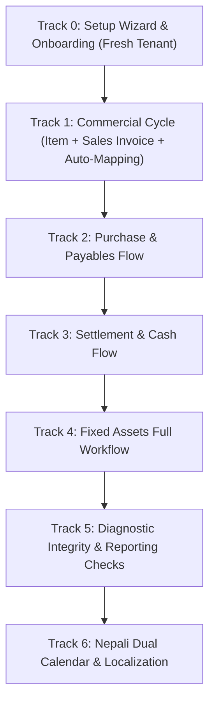

# Senior QA Test Scenarios & Verification Matrix

**Date:** 2026-11-21  
**Target:** Syasyah Samaj Billing (`apps/billing`)  
**Scope:** Setup Wizard, Commercial Flow, Fixed Assets, Diagnostics, Localization

---

## 1. Data Cleaning & Environment Strategy (Read First)

### Should you wipe or remove all database data?
**No. Do NOT perform a global database drop or Postgres wipe.**

A global wipe is counterproductive because:
1. It destroys user authentication tables (Better Auth credentials, passwords, session tokens).
2. It destroys tenant structures, permissions, and system migration state.
3. You will be locked out and have to re-run seed scripts from the CLI.

### The Recommended Senior QA Strategy:
Instead of a destructive database drop, use **Tenant-Scoped Isolation**:

| Approach | How It Works | When to Use |
| :--- | :--- | :--- |
| **A. Fresh Test Tenant (Recommended)** | Create or switch to a new tenant (e.g. `QA_TEST_ORG` or `Illaka 99`). Since this tenant has 0 accounts and no settings, the app automatically flags setup as incomplete and gates the user into the **`/setup` Onboarding Wizard**. | Testing the **Setup Wizard** from scratch without affecting any other data. |
| **B. Built-in Data Management (`/data`)** | Navigate to `/data` (`DataManagement.tsx`). Click **"Cleanup"** (wipes only transaction vouchers, journals, and balances while keeping accounts and items) or **"Reset"** (wipes masters and transactions for the *current tenant only*). | Resetting a tenant back to Day 1 to re-run transactions cleanly. |
| **C. Browser Storage Reset** | Open in **Incognito / Private Window** or clear Browser Storage (`Application > Storage > Clear site data`). | Verifying cold cache loads and offline IndexedDB initialization. |

---

## 2. Test Execution Matrix (Step-by-Step)

---

### Track 0: Setup Wizard & Onboarding Gate (Fresh Tenant)
*Prerequisite: Switch to an unconfigured tenant.*

- [ ] **Step 0.1: Onboarding Gate Trigger**
  - Log in and navigate to `/`.
  - **Expected**: Dashboard displays the `<SetupChecklist>` banner showing remaining steps (`4 steps left`). The "Save & Post" button on voucher forms should be disabled (drafts only).
- [ ] **Step 0.2: Company Profile**
  - Click Step 1 &rarr; navigate to `/settings` or `/setup`.
  - Enter: Company Name (*"Syasyah QA Test Pvt Ltd"*), PAN/VAT number (*"601234567"*), Address (*"Kathmandu, Ward 4"*).
  - Save &rarr; verify toast and checkmark on Step 1.
- [ ] **Step 0.3: Fiscal Year Setup**
  - Add active fiscal year (e.g. `2083/84` BS or `2026/27` AD).
  - Verify start date and end date align with Nepali Shrawan 1 to Ashad end.
- [ ] **Step 0.4: Chart of Accounts & Defaults Seeding**
  - In `/setup`, click "Seed Account Types & Groups" & "Seed Chart of Accounts".
  - Verify standard categories appear (Assets, Liabilities, Equity, Revenue, Expenses).
  - In "Default Accounts", verify the 8 core postings are mapped (`Receivable`, `Payable`, `Cash`, `Bank`, `Tax`, `Inventory`, `Revenue`, `Expense`).
- [ ] **Step 0.5: Gate Clearance**
  - Return to `/` (Dashboard).
  - **Expected**: Setup checklist disappears; "Save & Post" is enabled on all transaction forms.

---

### Track 1: Commercial Cycle (Sales & Revenue Flow)
*Tests the new `TransactionLine` component, calculation engine, auto-mapping, and reports.*

- [ ] **Step 1.1: Create Test Item with Mapped Accounts**
  - Navigate to `/items` &rarr; Click **+ Add Item**.
  - Name: *"Commercial Inverter 5kVA"*, Code: *"INV-001"*, Unit: *"Pcs"*, Price: *"Rs. 45,000"*.
  - Select `Sales Account`: *"4000 - Sales Revenue"*.
  - Select `Purchase Account`: *"5000 - Cost of Goods Sold / Purchase"*.
  - Select `Sales Tax Code`: *"13% VAT"*.
  - Save item & verify it appears in the table.
- [ ] **Step 1.2: Create Customer Party**
  - Navigate to `/parties` &rarr; Click **+ Add Party**.
  - Name: *"Himalayan Traders"*, Type: `Customer`, PAN: *"300123456"*.
- [ ] **Step 1.3: Sales Invoice Entry (`/vouchers/new?type=sales-invoice`)**
  - Pick customer: *"Himalayan Traders"*.
  - Line 1 (Item Workflow):
    - Select item *"INV-001"*.
    - **Verify**: Does Account automatically resolve to *"Sales Revenue"*?
    - **Verify**: Does Tax Code automatically resolve to *"13% VAT"*?
    - **Verify**: Set Qty: `2`, Rate: `45,000`. Line total should be `Rs. 90,000` + Tax `Rs. 11,700` = `Rs. 101,700`.
  - Line 2 (Manual Account Workflow):
    - Leave Item empty.
    - Select Account: *"Accounts Receivable"* (Asset) &rarr; **Verify**: Subaccount selector appears, prompting for customer/party.
    - Switch Account to *"Delivery Fee Income"* (Income) &rarr; **Verify**: Subaccount selector disappears or hides cleanly without UI jitter.
    - Remove Line 2.
  - Save & Post the invoice.
- [ ] **Step 1.4: Cross-Report Verification**
  - Open `/reports/receivables`: Is *"Himalayan Traders"* listed with `Rs. 101,700` in the **Current (0-30 days)** column?
  - Open `/reports/tax-summary`: Does `Rs. 11,700` appear under Output VAT?
  - Open `/reports/taxable-sales-customer`: Is *"Himalayan Traders"* listed with Taxable `Rs. 90,000` and Tax `Rs. 11,700`?
  - Open `/reports/pnl`: Does Sales Revenue reflect `Rs. 90,000`?

---

### Track 2: Purchase & Payables Flow

- [ ] **Step 2.1: Purchase Invoice Entry (`/vouchers/new?type=purchase-invoice`)**
  - Vendor: Create/pick *"National Suppliers"*.
  - Line 1: Pick *"INV-001"*, Qty: `5`, Rate: `35,000`, 13% VAT.
  - **Verify**: Account auto-resolves to purchase account (*"Cost of Goods Sold / Purchases"*).
  - Total: Base `Rs. 175,000` + VAT `Rs. 22,750` = `Rs. 197,750`.
  - Save & Post.
- [ ] **Step 2.2: Payables & Tax Check**
  - Open `/reports/payables`: Is *"National Suppliers"* outstanding balance `Rs. 197,750`?
  - Open `/reports/tax-purchase`: Is Input VAT listed as `Rs. 22,750`?
  - Open `/reports/inventory-valuation`: Has item quantity and AVCO valuation increased?

---

### Track 3: Settlement & Cash Flow

- [ ] **Step 3.1: Receipt Voucher (`/vouchers/new?type=receipt-voucher`)**
  - Customer: *"Himalayan Traders"*.
  - Amount: `Rs. 101,700` into Cash/Bank Account.
  - Save & Post.
  - **Verify in Receivables**: Outstanding balance drops to `Rs. 0`.
- [ ] **Step 3.2: Payment Voucher (`/vouchers/new?type=payment-voucher`)**
  - Vendor: *"National Suppliers"*, Pay `Rs. 100,000` partial payment.
  - Save & Post.
  - **Verify in Payables**: Remaining balance is `Rs. 97,750`.
- [ ] **Step 3.3: Cash Flow Statement (`/reports/cash-flow`)**
  - **Operating Activities**: Shows Cash received from customers (`+Rs. 101,700`) and Cash paid to suppliers (`-Rs. 100,000`).
  - **Net Movement**: `+Rs. 1,700`. Opening Cash + Movement = Closing Cash.

---

### Track 4: Fixed Assets Full Workflow

- [ ] **Step 4.1: Register Fixed Asset**
  - Navigate to `/fixed-assets` &rarr; Tab 1 (Register).
  - Click **+ Register Asset**:
    - Name: *"Mac Studio M2"*, Code: *"AST-01"*, Category: `computer`.
    - Purchase Cost: `Rs. 240,000`, Salvage Value: `Rs. 0`, Life: `4 years` (`Rs. 5,000/month`).
    - Purchase Date: 2 months prior to today.
  - Save & verify it appears with Net Book Value `Rs. 240,000`.
- [ ] **Step 4.2: Batch Depreciation Run**
  - Navigate to Tab 2 (**Depreciation Run**).
  - Pick Current Period.
  - Click **Preview**:
    - **Verify**: Does *"AST-01"* appear with 2 elapsed periods (`Rs. 10,000` total)?
  - Click **Post Depreciation**:
    - **Verify**: Success toast; journal entries generated (`Dr. Depreciation Expense, Cr. Accumulated Depreciation`).
  - Return to Register: Accumulated Depreciation should be `Rs. 10,000`, Net Book Value `Rs. 230,000`.
- [ ] **Step 4.3: Asset Disposal**
  - In `/fixed-assets`, trigger **Dispose** on *"AST-01"*:
    - Date: Today.
    - Proceeds: `Rs. 200,000` (Bank account).
    - Expected calculation: Book Value is `Rs. 230,000`, Proceeds `Rs. 200,000` &rarr; **Loss on Disposal: Rs. 30,000**.
  - Confirm disposal.
  - **Verify**: Asset status flips to `disposed`; disposal journal is generated and balanced.

---

### Track 5: Integrity Checks & Reports Hub

- [ ] **Step 5.1: Transaction Health Audit**
  - Navigate to `/reports/transaction-health`.
  - **Expected**: All 9 diagnostic checks run (Unbalanced Journals, Orphan Lines, Account Type Discrepancies, etc.).
  - Ensure zero critical integrity failures.
- [ ] **Step 5.2: Trial Balance Reconciliation**
  - Navigate to `/reports/trial-balance`.
  - Total Debits **MUST EQUAL** Total Credits down to 2 decimal places.
- [ ] **Step 5.3: Balance Sheet Reconciliation**
  - Navigate to `/reports/balance-sheet`.
  - Check fundamental accounting equation: `Assets = Liabilities + Equity`.
  - Difference should show `Rs. 0.00` (or balanced indicator).

---

### Track 6: Nepali Dual-Calendar & Localization Edge Cases

- [ ] **Step 6.1: Calendar Switcher**
  - On any report date range (e.g. `/reports/general-ledger`), toggle between **BS (Bikram Sambat)** and **AD**.
  - **Verify**: Date string converts accurately (e.g. 2083-08-01 BS); does not reset or jump to 1970.
- [ ] **Step 6.2: Language Switching**
  - Switch app language to Nepali (**नेपाली**).
  - Verify that Reports Hub, Transaction Form labels, and column headers are translated without untranslated raw keys (e.g., no `reports.taxReconciliation` strings).
- [ ] **Step 6.3: Export to CSV and PDF**
  - Export General Ledger to CSV &rarr; Open file; check that Devanagari text and numbers are properly encoded (UTF-8 with BOM).
  - Export to PDF &rarr; Verify table does not clip or overflow page boundaries.
